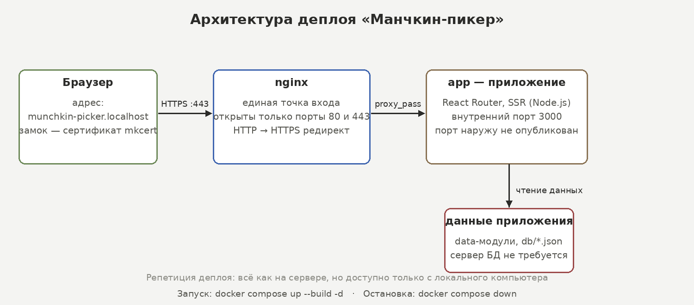

# Деплой «Манчкин-пикер» (репетиция)

Репетиция деплоя по практическому занятию №18: проект развёрнут на локальном
компьютере так, как он был бы развёрнут на сервере (продакшен-сборка,
контейнеры, веб-сервер nginx, HTTPS с локальным сертификатом, локальное
доменное имя), но **без публикации в Интернет** — в соответствии с
требованиями 152-ФЗ «О персональных данных» для учебных проектов.



## Схема архитектуры

Браузер → **nginx** (единая точка входа, порты 80/443, TLS) → **app**
(веб-приложение React Router с SSR, внутренний порт 3000, наружу не
опубликован) → данные приложения (data-модули и db/*.json, сервер БД не
требуется).

## Сервисы

| Сервис | Технология | Внутренний порт | Продакшен-сервер | Порты наружу |
|---|---|---|---|---|
| `nginx` | nginx:alpine (обратный прокси) | 80, 443 | сам является веб-сервером | **80, 443** |
| `app` | Node.js 24, react-router-serve | 3000 | Node.js-сервер (встроен) | нет |

## Домен и сертификат

- локальное доменное имя: `munchkin-picker.localhost`;
- сертификат выпущен утилитой mkcert (локальный центр сертификации):
  `mkcert -cert-file munchkin-picker.localhost.pem -key-file
  munchkin-picker.localhost-key.pem munchkin-picker.localhost`;
- файлы сертификата кладутся в `deploy/certs/` (в репозиторий не попадают —
  см. .gitignore);
- имя домена совпадает в трёх местах: команда mkcert, `server_name` и пути
  `ssl_certificate*` в `deploy/nginx/nginx.conf`.

## Переменные окружения и секреты (только имена)

| Имя | Назначение | Где задаётся |
|---|---|---|
| `PORT` | внутренний порт приложения | docker-compose.yml |
| `SESSION_SECRET` | секрет подписи cookie-сессии | docker-compose.yml (переменная окружения этапа запуска) |
| `SUPABASE_URL` | адрес проекта Supabase (облачная БД) | `.env` рядом с docker-compose.yml / окружение |
| `SUPABASE_SERVICE_ROLE_KEY` | серверный ключ доступа к Supabase (секрет!) | `.env` рядом с docker-compose.yml / окружение |

Секрет сессии и ключи Supabase читаются в коде только через
`process.env` (app/auth.server.ts, app/supabase.server.ts) и попадают в
контейнер только на этапе запуска, не при сборке. `.env`-файлы и
сертификаты в репозиторий не включаются (шаблон — `.env.example`).
Если переменные Supabase не заданы, приложение работает на локальных
резервных данных (app/db.server.ts).

## Команды

```bash
# выпуск сертификата (один раз; из папки deploy/certs)
mkcert -cert-file munchkin-picker.localhost.pem \
       -key-file munchkin-picker.localhost-key.pem munchkin-picker.localhost

# запуск (из папки deploy)
docker compose up --build -d

# проверка: все сервисы должны быть Up
docker compose ps

# журналы при диагностике
docker compose logs app
docker compose logs nginx

# остановка
docker compose down
```

Проверка в hosts не требуется: домены `*.localhost` Windows разрешает в
адрес 127.0.0.1 автоматически.

## Проверка работы

- адрес: **https://munchkin-picker.localhost** — открывается без
  предупреждений о сертификате (замок в адресной строке), HTTP автоматически
  перенаправляется на HTTPS;
- скриншоты: `docker compose ps`, страница с замком, вкладка Network,
  контейнеры в Docker Desktop — в папке `screenshots/`.

## Ошибки при выполнении и их устранение

- `failed to read dockerfile` при ручной сборке — команда `docker build`
  выполнялась не из корня проекта; контекст сборки задаётся в
  docker-compose.yml (`context: ..`) и при `docker compose up --build`
  указывать путь вручную не нужно;
- предупреждение о сертификате в браузере — не совпадало имя домена между
  mkcert, `server_name` и путями к сертификату; после выпуска сертификата с
  тем же именем и перезапуска устранено;
- HTTP вместо HTTPS — набран адрес `http://…`; nginx настроен на редирект
  301 на HTTPS.

## Что нужно изменить для публикации на реальном сервере

1. Арендовать сервер (VPS) у хостинг-провайдера, соответствующего
   требованиям 152-ФЗ (хранение данных на серверах в РФ), и настроить SSH-
   доступ.
2. Зарегистрировать доменное имя в DNS и направить его на IP сервера
   (заменив локальный `munchkin-picker.localhost` на реальный домен).
3. Выпустить сертификат у публичного центра сертификации (Let's Encrypt,
   certbot) вместо локального mkcert.
4. Заменить в nginx.conf `server_name` и пути сертификата; на сервере
   поднять этот же стек (docker compose up -d), выгрузив образы из GHCR
   (`docker pull ghcr.io/noneme-netizen/vebka_64-66:latest`) — это этап CD,
   непрерывной доставки.
5. Настроить доставку изменений: после merge в main CI публикует образ в
   GHCR, сервер по webhook или по расписанию подтягивает новый образ и
   перезапускает контейнеры.

## Дополнительное задание (CD)

Публикация образа в GitHub Container Registry из CI настроена ранее
(занятие 64-66): workflow `.github/workflows/build.yml` после проверки
типов собирает образ и публикует его с тегами `latest` и хэшем коммита;
workflow также поддерживает ручной запуск (workflow_dispatch).
