# Аудит веб-приложения «Манчкин-пикер»

Практическое занятие № 19–20 (79–80): аудит производительности, доступности, лучших практик и SEO в продакшен-режиме.

- **Проверяемый адрес:** `https://munchkin-picker.localhost` (локальный продакшен в Docker: `nginx` + Node.js SSR + Supabase)
- **Стек:** React Router v8 (SSR), Tailwind CSS, PostgreSQL (Supabase) + Supabase Storage
- **Ограничения среды:** проект не публикуется в сети Интернет (152-ФЗ «О персональных данных»), проверка выполнена в окне инкогнито (InPrivate) браузера Microsoft Edge, режим Lighthouse — **Navigation**, устройство — **Desktop**.

---

## 1. Список страниц для аудита

| Страница | Тип страницы | Как проверялась | Категории Lighthouse |
|---|---|---|---|
| `/` | публичная, есть в `sitemap.xml` | окно инкогнито, 3 запуска | все 4 |
| `/catalog` | публичная, есть в `sitemap.xml` | окно инкогнито, 3 запуска | все 4 |
| `/picker` | публичная, есть в `sitemap.xml` | окно инкогнито, 3 запуска | все 4 |
| `/catalog/orig` | публичная карточка версии, есть в `sitemap.xml` | окно инкогнито, 3 запуска | все 4 |
| `/login` | форма входа, метатег `noindex` | окно инкогнито, 3 запуска | без SEO |
| `/signup` | форма регистрации, метатег `noindex` | окно инкогнито, 3 запуска | без SEO |
| `/collection` | закрытая страница (`noindex`, нужен вход) | после входа в том же окне инкогнито, 1 запуск | без SEO |
| `/friends` | закрытая страница (нужен вход) | после входа в том же окне инкогнито, 1 запуск | без SEO |

> **Примечание по закрытым страницам:** для проверки `/collection` и `/friends` использовался тестовый аккаунт без личных данных, а категория SEO отключалась, так как эти страницы закрыты от поисковой индексации.

---

## 2. Результаты Lighthouse «ДО» (по 3 запуска, медиана)

### 2.1. Оценки по четырём категориям

| Страница | Запуски Performance | Медиана Performance | Accessibility | Best Practices | SEO | Отчёт HTML |
|---|---|---|---|---|---|---|
| `/` | 100, 99, 100 | **100** | **95** | 100 | 100 | [home.html](reports/home.html) |
| `/catalog` | 99, 91, 97 | **97** | 100 | 100 | 100 | [catalog.html](reports/catalog.html) |
| `/picker` | 99, 100, 99 | **99** | 100 | 100 | 100 | [picker.html](reports/picker.html) |
| `/catalog/orig` | 98, 89, 94 | **94** | **95** | 100 | 100 | [game.html](reports/game.html) |
| `/login` | 100, 100, 100 | **100** | **92** | 100 | — | [login.html](reports/login.html) |
| `/signup` | 100, 100, 100 | **100** | **93** | 100 | — | [signup.html](reports/signup.html) |
| `/collection` | 99 | **99** | 100 | 100 | — | [collection.html](reports/collection.html) |
| `/friends` | 99 | **99** | 100 | 100 | — | [friends.html](reports/friends.html) |

### 2.2. Метрики Performance медианного запуска

| Страница | FCP | LCP | TBT | CLS | Speed Index |
|---|---|---|---|---|---|
| `/` | 0,5 с | 0,5 с | 0 мс | 0 | 1,0 с |
| `/catalog` | 0,5 с | 0,5 с | 0 мс | 0 | 1,8 с |
| `/picker` | 0,6 с | 0,6 с | 0 мс | 0 | 1,2 с |
| `/catalog/orig` | 0,6 с | 0,8 с | 0 мс | 0,053 | 2,2 с |
| `/login` | 0,5 с | 0,6 с | 0 мс | 0 | 0,5 с |
| `/signup` | 0,5 с | 0,5 с | 0 мс | 0 | 0,5 с |
| `/collection` | 0,5 с | 0,5 с | 0 мс | 0 | 1,3 с |
| `/friends` | 0,5 с | 0,5 с | 0 мс | 0 | 1,3 с |

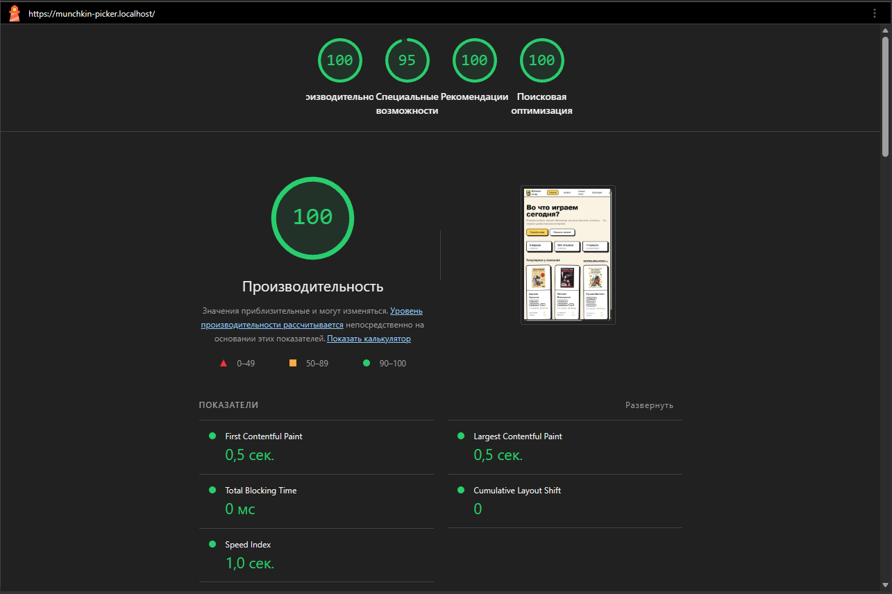
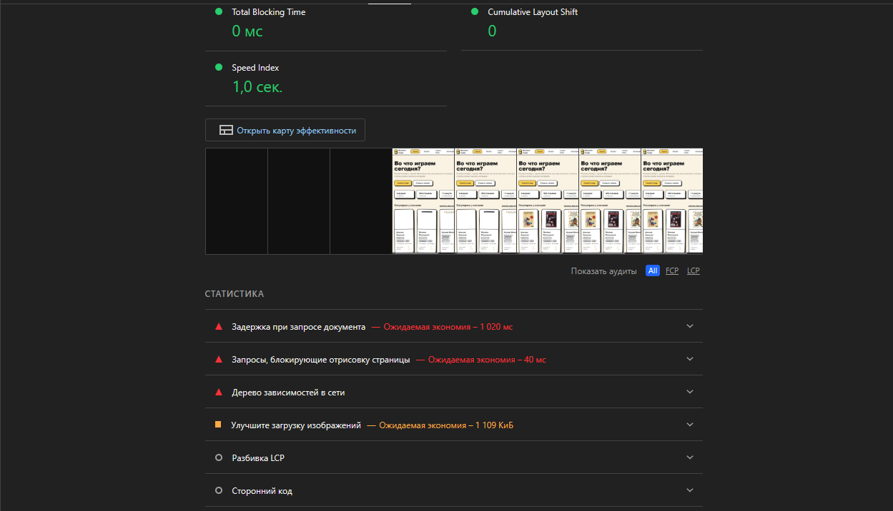

### 2.3. Разбор причин из отчётов Lighthouse (Insights и Diagnostics)

1. **`link-name` (`Accessibility 92–93` на `/login`, `/signup`)** — в шапке сайта (`Header.tsx`) ссылка на страницу входа для гостя оформлена круглой иконкой `<svg>` без текста и без `aria-label`. Программы экранного доступа видят её как пустую ссылку.
2. **`color-contrast` (`Accessibility 95` на `/`, `/catalog/orig`)** — цвет звёзд рейтинга (`--color-gold: #ffc53f`) на белом фоне карточки имеет недостаточную контрастность (`span.text-gold`).
3. **`image-delivery-insight` (экономия до 2 159 КиБ на `/catalog`, 1 109 КиБ на `/`, 681 КиБ на `/collection`)** — фотографии коробок в Supabase Storage хранились в PNG размером 274–534 КБ (401×605 px) при размере контейнера на карточке ~96×144 px.
4. **`lcp-discovery-insight` (`/catalog/orig`)** — на основной картинке коробки отсутствует атрибут `fetchpriority="high"`.
5. **`server-response-time` (880–2 500 мс, выброс 12 240 мс на втором запуске `/catalog/orig`)** — при каждом запросе страницы SSR-сервер ждёт ответа от облачной базы Supabase в регионе `eu-central-1`.
6. **`unused-javascript` (51–55 КиБ) и `render-blocking-insight` (40–80 мс)** — базовый CSS-файл Tailwind/React Router и часть клиентского бандла роутера.

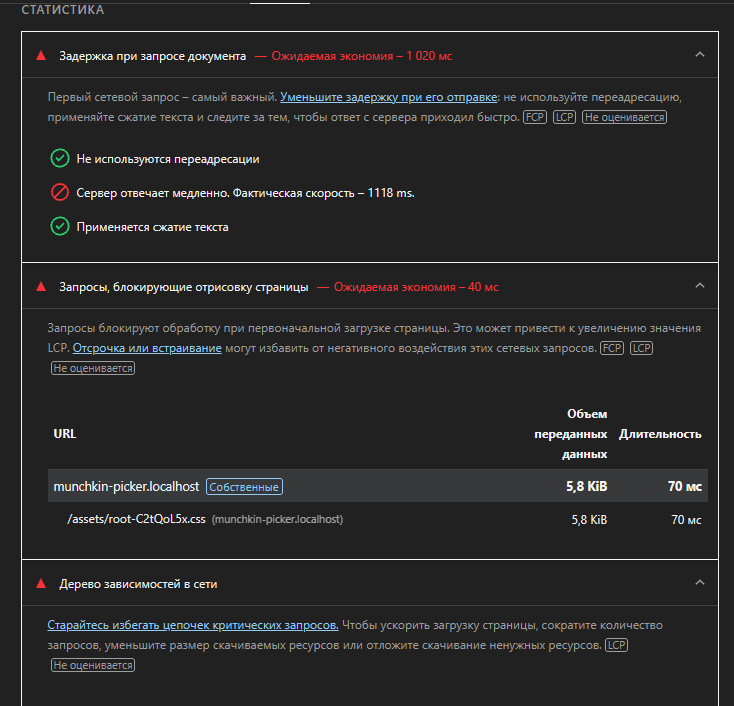
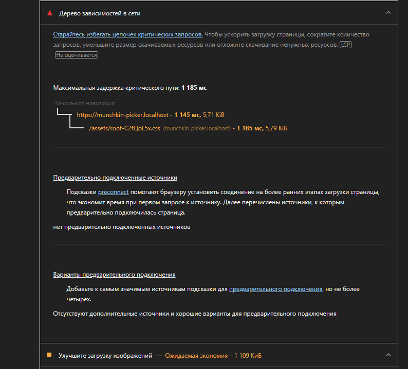
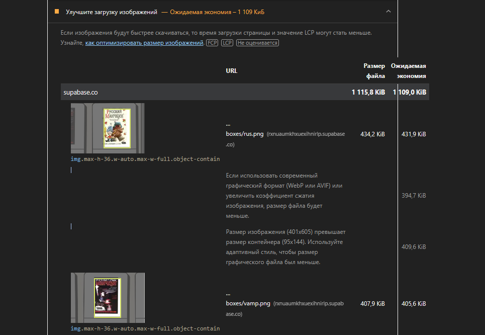
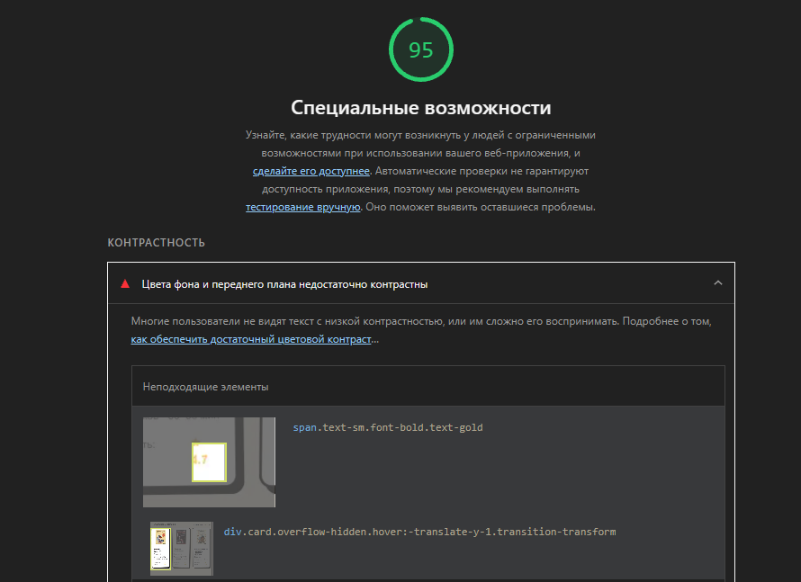

---

## 3. Core Web Vitals (живые метрики на вкладке Performance)

На интерактивных страницах выполнены реальные сценарии: фильтрация каталога по тематике и сложности, вращение колеса на «Слепом пикере» и переключение фильтров статуса в коллекции.

| Страница | LCP | Оценка LCP | INP | Оценка INP | CLS | Оценка CLS | Комментарий |
|---|---|---|---|---|---|---|---|
| `/catalog` | 1,81 с | хорошо | 32 мс | хорошо | 0 | хорошо | Самое долгое взаимодействие — переключение чекбокса фильтра (`pointer`) |
| `/picker` | 0,84 с | хорошо | 40 мс | хорошо | 0 | хорошо | Самое долгое взаимодействие — запуск вращения колеса (`pointer`) |
| `/collection` | 2,12 с | хорошо | 32 мс | хорошо | 0 | хорошо | Переключение фильтра статусов и выпадающих списков; сдвигов макета нет благодаря SSR и фиксированным `width`/`height` картинок |

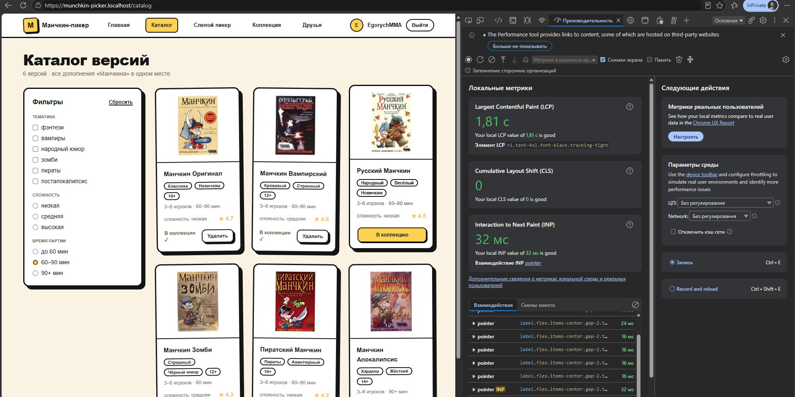
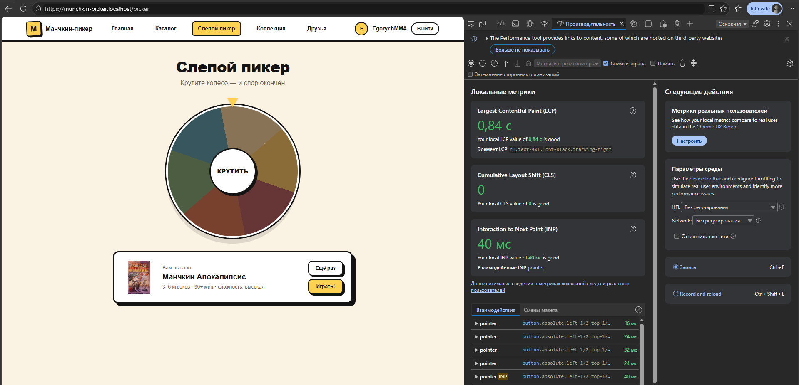
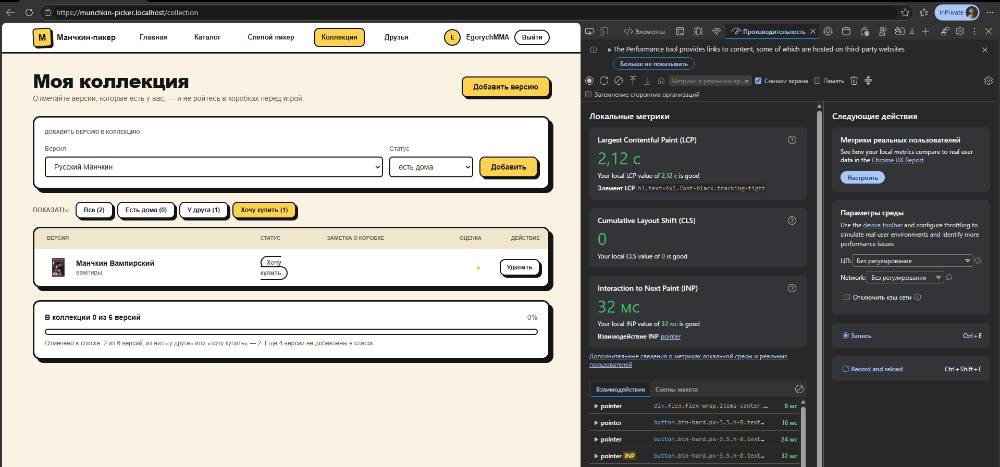

---

## 4. Ручные проверки (до исправлений)

| Проверка | Страница | Результат | Комментарий |
|---|---|---|---|
| Атрибут `lang` у `<html>` | все | есть | `lang="ru"` присутствует в исходном HTML |
| Тег `<title>` и `<meta description>` | `/`, `/catalog`, `/catalog/orig`, `/picker` | есть | Уникальные заголовки и осмысленные описания формируются на сервере |
| Контент в исходном HTML (`Ctrl+U`) | `/catalog`, `/login` | есть | Благодаря SSR весь текст, ссылки и preload-ссылки картинок приходят сразу с сервера |
| Атрибут `alt` у картинок | `/`, `/catalog`, `/catalog/:slug` | есть | Заполнен названием соответствующей версии «Манчкина» |
| Метатег `noindex` | `/login`, `/signup`, `/collection`, `/friends` | частично | На `/login`, `/signup`, `/collection` тег был, но на `/friends` (`PrivateGate` для гостей) его не было |
| Противоречие `robots.txt` и `noindex` | `/robots.txt` | **проблема** | В `robots.txt` были закрыты `/login`, `/signup`, `/collection`, из-за чего робот не мог их загрузить и увидеть `noindex` |
| Лишний адрес в `sitemap.xml` | `/sitemap.xml` | **проблема** | В карте сайта была указана закрытая страница `/friends` |
| Навигация с клавиатуры (`Tab`) | `/` | хорошо | Фокус по очереди переходит по ссылкам и кнопкам шапки с чёткой рамкой |
| Мобильный вид (эмуляция 440 px) | `/`, `/catalog` | **проблема** | Шапка и боковая панель фильтров `w-72` не адаптированы под узкий экран, карточки сжимаются |

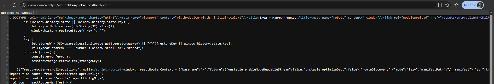
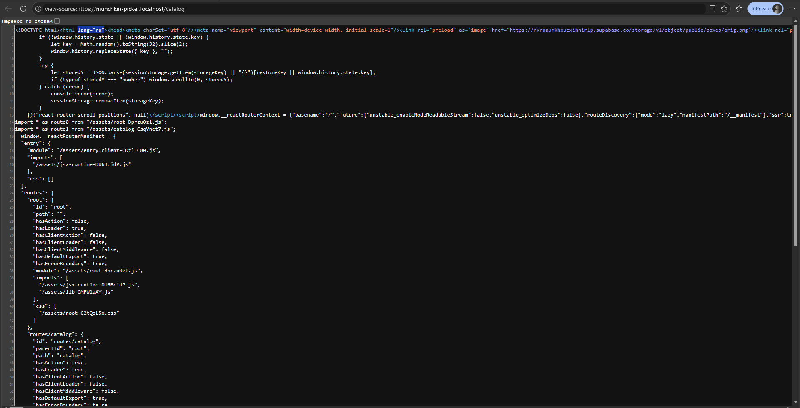
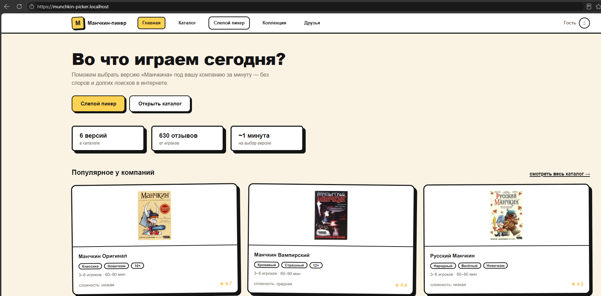
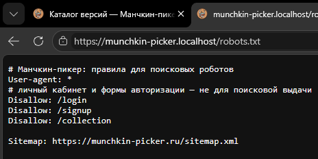
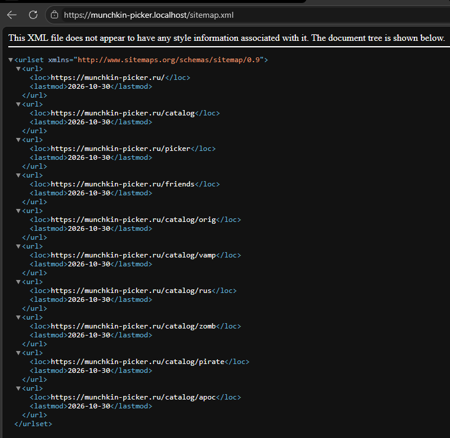
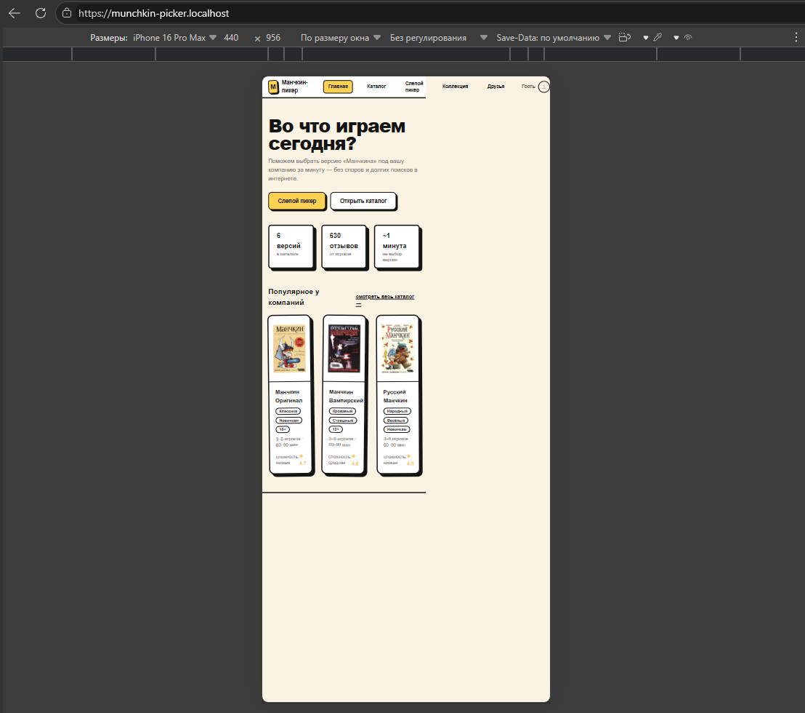
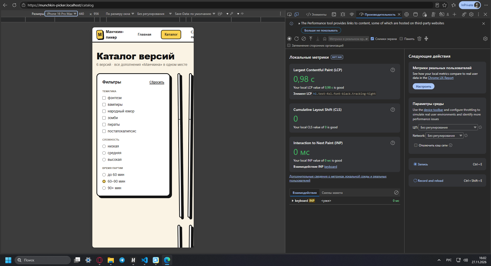

### Сравнение с занятием 70–71 (`before` / `after`)

На практическом занятии 70–71 были добавлены базовые SEO-теги, `robots.txt`, `sitemap.xml` и размеры `width`/`height` у фотографий коробок, что подняло оценку SEO до 100 и убрало сдвиг макета (CLS стал 0). Однако полный аудит на этом занятии выявил то, что автоматическая проверка SEO не видит: противоречие между `Disallow` в `robots.txt` и `noindex`, присутствие закрытой страницы `/friends` в `sitemap.xml`, а также проблемы доступности (`link-name`, `color-contrast`) и неоптимизированный формат PNG у новых фотографий коробок.

---

## 5. Сравнение с сайтом-аналогом (PageSpeed Insights)

В качестве реального сайта-аналога выбран крупнейший российский магазин настольных игр **Hobby Games** (`https://hobbygames.ru/`), на котором продаётся и серия «Манчкин».

| Показатель | Наш проект (лабораторные, Desktop) | Аналог `hobbygames.ru`: полевые данные (Mobile) | Аналог `hobbygames.ru`: полевые данные (Desktop) | Аналог `hobbygames.ru`: Lighthouse (Mobile) |
|---|---|---|---|---|
| **LCP** | 0,5–0,8 с | 2,1 с | 2,0 с | 3,8 с |
| **INP** | 32–40 мс (живые метрики) | 144 мс | 60 мс | — |
| **CLS** | 0 | 0 | 0 | 0,001 |
| **Performance** | 94–100 | — | — | **63** |
| **Accessibility** | 95–100 (после — 100) | — | — | **69** |
| **Best Practices** | 100 | — | — | **73** |
| **SEO** | 100 | — | — | **85** |

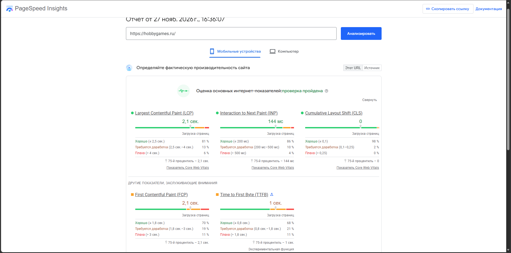
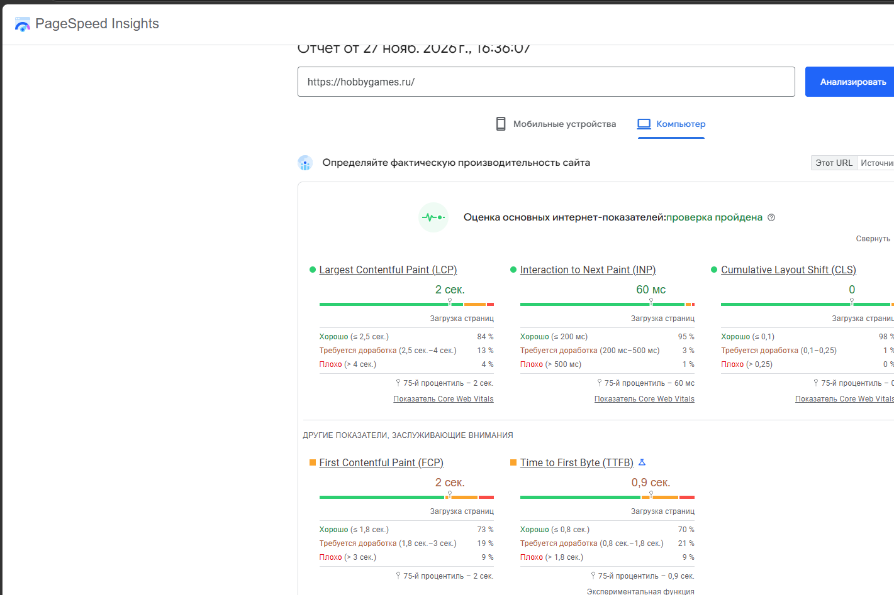
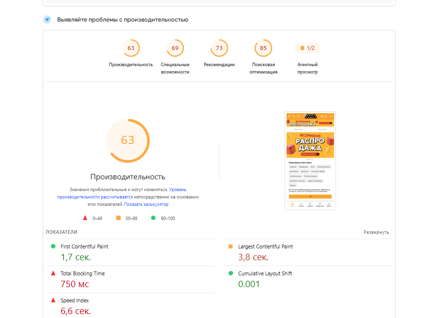

### Выводы по сравнению
1. У реального крупного сайта `hobbygames.ru` в полевых данных все три метрики Core Web Vitals находятся в зелёной зоне (`LCP 2,1 с`, `INP 144 мс`, `CLS 0`), однако в лабораторном мобильном тесте Lighthouse производительность падает до 63 баллов из-за большого времени блокировки (`TBT 750 мс`) и `LCP 3,8 с`.
2. Сравнивать наши лабораторные цифры Desktop напрямую с мобильным замером PageSpeed нельзя: мобильная проверка искусственно замедляет процессор и сеть, а наш проект проверялся локально. При этом по структуре доступности и чистоте кода (Accessibility 100, Best Practices 100, SEO 100, TBT 0 мс) наш проект не уступает и опережает коммерческий аналог.
3. Как и у многих крупных интернет-магазинов, у `hobbygames.ru` высокий `TTFB` (1 с на мобильных, 0,9 с на десктопе) — та же причина (ожидание ответа от сервера/БД) присутствует и в нашем проекте.

---

## 6. Найденные проблемы и приоритеты

| Приоритет | Проблема | Страница | Влияние | Сложность | Как исправить |
|---|---|---|---|---|---|
| **1** | Нет `aria-label` у ссылки-иконки входа (`Accessibility 92–93`) | все (в режиме Гостя) | высокое | низкая | Добавить `aria-label="Войти в аккаунт"` и `title` в `app/components/Header.tsx` |
| **2** | Недостаточная контрастность цвета рейтинга `--color-gold` (`Accessibility 95`) | `/`, `/catalog/orig` | среднее | низкая | Затемнить `--color-gold` в `app/app.css` до `#9a6700` (контраст > 4.5:1) |
| **3** | Тяжёлые PNG-картинки коробок (~2,2 МБ суммарно, экономия до 2 159 КиБ) | `/`, `/catalog`, `/catalog/:slug`, `/collection` | среднее | низкая | Конвертировать коробки в WebP (высота 340 px, 16–25 КБ), загрузить в бакет `boxes` Supabase и обновить `photo_path` |
| **4** | Противоречие `robots.txt`, `sitemap.xml` и `noindex` | `/robots.txt`, `/sitemap.xml`, `/friends` | среднее | низкая | Убрать `Disallow` со страниц с `noindex`, убрать `/friends` из `sitemap.xml` и добавить ей `noindex` |
| **5** | Нет `fetchpriority="high"` у главной картинки LCP | `/catalog/orig`, `/`, `/catalog` | среднее | низкая | Добавить `fetchPriority="high"` на фото игры и первую карточку |
| **6** | Нет адаптивной вёрстки под мобильные экраны (375–440 px) | `/`, `/catalog`, `/friends` | высокое | высокая | Переделать сетки `grid-cols-3` и боковые панели под мобильные брейкпоинты (остаётся на следующий этап) |
| **7** | Высокое время ответа сервера (`TTFB` 990–2 500 мс) | все динамические страницы | среднее | средняя | Добавить серверное кэширование каталога и отзывов (сейчас каждый SSR-запрос идёт в Supabase) |
| **8** | Неиспользуемый JavaScript (~52 КиБ) и блокирующий CSS (40 мс) | все страницы | низкое | высокая | Разделение кода и инлайнинг критического CSS |

---

## 7. Исправления и результат «было — стало»

Были исправлены проблемы с **приоритетами 1–5** (плюс поправлена вёрстка бейджа статуса «Хочу купить» в таблице `/collection`).

### 7.1. Сравнение оценок и метрик

| Страница | Performance (было → стало) | Accessibility (было → стало) | SEO (было → стало) | Экономия на картинках / заметка |
|---|---|---|---|---|
| `/` | 100 → **100** | 95 → **100** | 100 → **100** | Speed Index `1,0 → 0,9 с`; экономия по картинкам `1 109 → 49 КиБ`; отчёт: [home_after.html](reports/home_after.html) |
| `/catalog` | 97 → **100** | 100 → **100** | 100 → **100** | Вес коробок снижен с ~2,2 МБ (PNG) до ~115 КБ (WebP) |
| `/catalog/orig` | 94 → **98** | 95 → **100** | 100 → **100** | Добавлен `fetchpriority="high"`, исправлена контрастность звёзд |
| `/login` | 100 → **100** | 92 → **100** | — | Исправлен `link-name` у иконки входа в шапке |

### 7.2. Скриншоты «ПОСЛЕ»

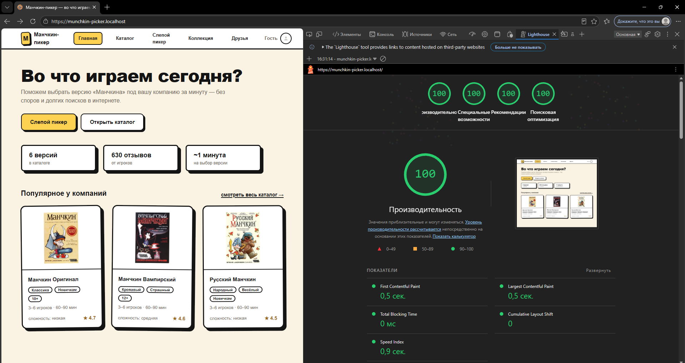
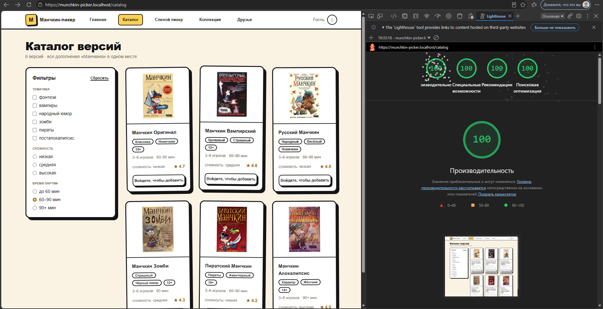
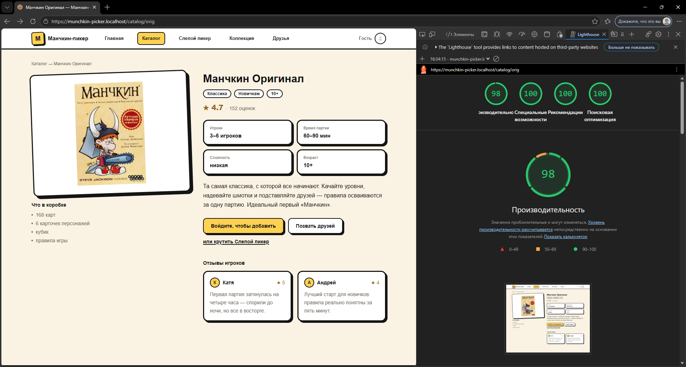
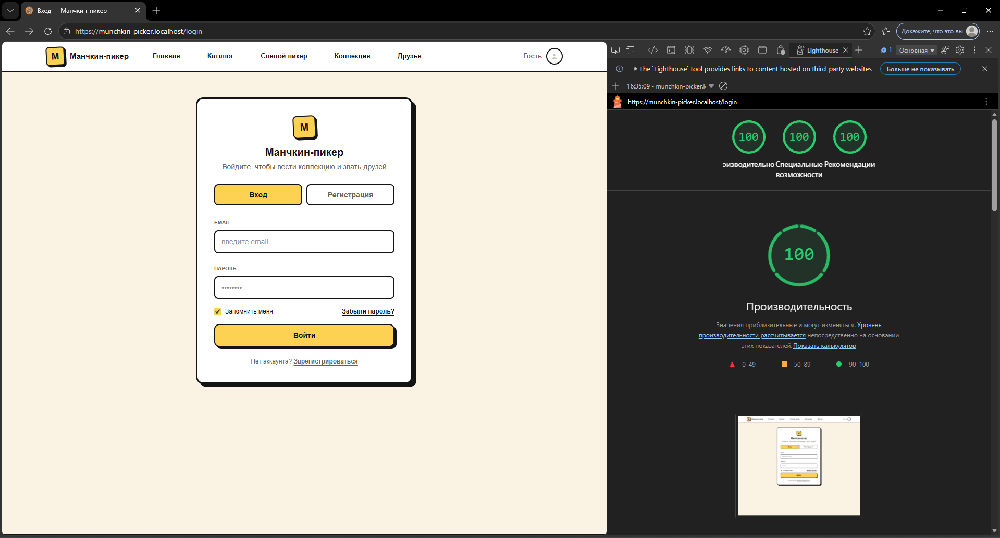
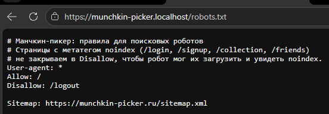
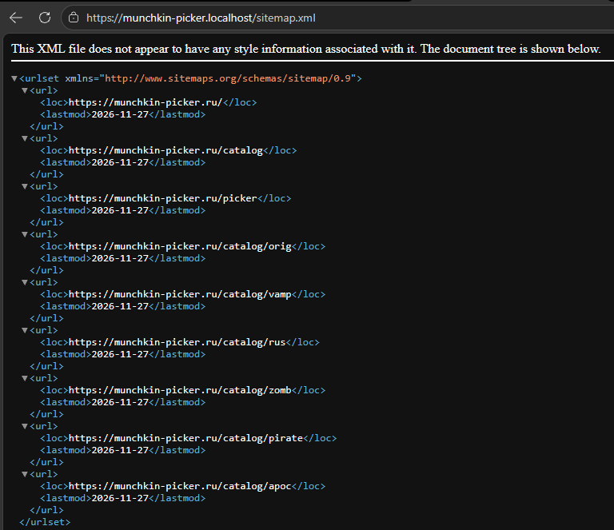

---

## 8. Проблемы, оставшиеся неисправленными

1. **Отсутствие адаптивной вёрстки (приоритет 6)** — требует переработки макетов всех страниц (`Header`, `catalog`, `friends`, `game`) под мобильные устройства; по заданию практической работы не исправлялась, зафиксирована для доработки.
2. **Время ответа сервера `TTFB` (~1 с) (приоритет 7)** — вызвано сетевой задержкой при каждом обращении SSR-сервера к облачной БД Supabase (`eu-central-1`); решается добавлением серверного кэша с TTL для редко меняющегося каталога игр.
3. **Неиспользуемый JavaScript (~52 КиБ) (приоритет 8)** — базовая часть клиентского рантайма React Router, дальнейшая оптимизация даёт минимальный выигрыш при высокой трудоёмкости.
